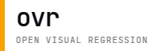

<p align="center">
  <picture>
    <source media="(prefers-color-scheme: dark)" srcset=".github/assets/logo-dark.png">
    <source media="(prefers-color-scheme: light)" srcset=".github/assets/logo-light.png">
    
  </picture>
</p>

<p align="center">
  Self-hosted, scalable visual regression testing.
</p>

<p align="center">
  <a href="https://github.com/open-visual-regression/open-visual-regression/actions/workflows/ci.yml"></a>
  <a href="https://www.npmjs.com/package/@open-visual-regression/cli"></a>
  <a href="./LICENSE"></a>
</p>

<p align="center">
  <a href="https://docs.openvisualregression.com">Documentation</a>
</p>

---

OVR captures screenshots from your UI and diffs them against approved baselines. It runs entirely on your own infrastructure: a web dashboard, a worker that captures and diffs snapshots with Playwright, and a CLI that CI pipelines run to upload a build.

- **No separate test files.** Point it at a `storybook build` output instead of writing and maintaining dedicated visual test files.
- **Review workflow.** Visual diffs that cross the threshold go into a review queue.
- **Git status checks.** Connect a project to your Git provider and OVR posts build/review status as a commit check, so a pull request can gate on it.
- **Bring your own infra.** Postgres, Redis, and any S3-compatible storage. Self-hosted or managed, your call.

## Why OVR?

Unit tests check what a component does, not how it looks. A component can pass every test and still ship with broken spacing, a clipped label, or a layout that only breaks at one screen width. That's easy to miss in a code review, whether a person or an AI agent wrote the change.

Comparing screenshots is deterministic. Every story, at every viewport, on every commit, OVR shows exactly what changed, and a reviewer decides whether that was the intent.

## Usage

Once you have a project and an API key, upload a build from CI:

```sh
npx @open-visual-regression/cli upload storybook \
  --dir storybook-static \
  --server-url https://ovr.example.com \
  --branch "$BRANCH" \
  --commit "$COMMIT_SHA" \
  --name "$(git log -1 --pretty=%s)" \
  --author "$(git log -1 --pretty=%an)"
```

See the [docs](https://docs.openvisualregression.com) for self-hosting (Docker, Kubernetes, managed Postgres/Redis/S3), CI setup, and the CLI reference.

## License

[Elastic License 2.0](./LICENSE): source-available, free to self-host and modify. The one restriction: you may not offer OVR to third parties as a hosted or managed service.

## Contributing

This is a pnpm/Turborepo monorepo. See [CONTRIBUTING.md](./CONTRIBUTING.md) for local setup, workspace layout, and development workflow.
