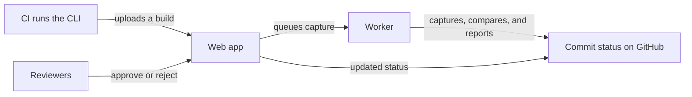

## The pieces

An **organization** is everything on one OVR server: its people and its projects.

A **project** is one UI you test, usually one repository's Storybook. It has a main branch, API keys for uploading, and settings such as how many reviewers a change needs.

A **build** is one upload from CI, for one commit on one branch.

A **snapshot** is one image OVR captures from a build. It's identified by its name, its viewport, and the browser it was captured in, so one component at two viewports gives two snapshots.

A **baseline** is the approved image of a snapshot. Each new snapshot is compared with its baseline, and the comparison is a **diff**.

A **review** is people approving or rejecting the diffs that changed.

## From upload to check

1. CI builds your UI and uploads it with the [CLI](/cli/overview). The upload names the branch and commit.
2. A worker opens the build in a browser and captures a snapshot at each viewport.
3. The worker compares each snapshot with its baseline. A snapshot is unchanged when the share of pixels that differ is at or below the diff threshold, 5% by default. Above that, it has changed.
4. The build gets a [status](/reference/statuses), and OVR posts it as a commit status when the project has a [git integration](/manage/git-status-checks).
5. If anything changed, reviewers approve or reject it, and the status updates.

## The main branch and other branches

OVR treats the project's main branch differently from every other branch.

**On the main branch**, OVR approves every change automatically. Whatever main looks like is, by definition, what's approved: each changed snapshot gets the `auto_approved` status and becomes the new baseline.

**On any other branch**, a changed snapshot needs review, and so does a new one that has no baseline yet. The branch is compared against main [as it was when the branch was cut](/baselines#branch-builds), so changes that land on main in the meantime don't show up as changes on the branch.

Approving a change on a branch lets the pull request pass. It becomes the baseline when it's merged and main's next build captures it.

## Reviews

Each changed snapshot is reviewed on its own. Reviewers vote to approve or reject it, on the build page or with the CLI. A snapshot is approved once it has as many approvals as the project's **required reviewers**, one by default. A single rejection rejects it.

The build's status follows its snapshots: it's rejected if any snapshot is rejected, needs review while any snapshot still does, and approved once every changed snapshot is.

Only the latest build on a branch can be reviewed. When you push a new commit, its build replaces the previous one, and OVR cancels the previous build if it's still running.

Admins and reviewers can vote. Viewers can see everything but can't vote. See [Users and roles](/manage/users-and-roles).

## Retention

Each night, OVR deletes each project's builds that are older than its retention period, 90 days by default. A build that holds a current baseline is kept, however old it is.

## What runs where

OVR is two services:

- The **web app** serves the dashboard and the API the CLI talks to, and records reviews.
- The **worker** captures snapshots in headless browsers and compares them with their baselines.

Both use Postgres for data, Redis for the queue of work, and S3-compatible object storage for uploaded builds and images. You can run several workers to capture more at once. See [Self-hosting](/self-hosting/docker-compose).
